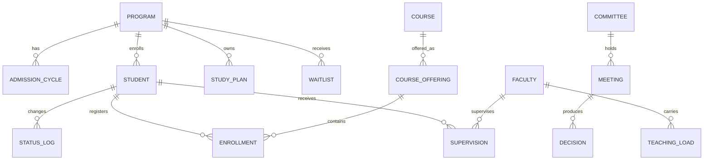

# التصميم الوظيفي لنظام إدارة الدراسات العليا

## 1. الهيكل العام

## 2. لوحات المعلومات
- **لوحة الإدارة التنفيذية:** الطلبة المنتظمون، البرامج النشطة، أعضاء هيئة التدريس، قوائم الانتظار، المتوقع تخرجهم، القرارات المفتوحة.
- **لوحة القبول والطاقة:** المتقدمون/المقبولون/المسجلون حسب البرنامج والمسار والسنة، نسبة القبول، إشغال الطاقة، اتجاهات السنوات.
- **لوحة النجاح والتخرج:** نسب الإنجاز، المتوقع تخرجهم، حالات التأجيل والانسحاب، المقررات الحرجة.
- **لوحة الموارد:** العبء الفعلي مقابل المعياري، الإشراف النشط، حالات التجاوز، فجوة التخصصات والتقاعد المتوقع.
- **لوحة اللجان:** الاجتماعات القادمة، القرارات المتأخرة، بنود التنفيذ حسب اللجنة.

## 3. سير العمل
1. **القبول:** دورة قبول → تسجيل المتقدمين → قرار قبول → تسجيل فعلي → تحديث الطاقة وقائمة الانتظار.
2. **تغيير الحالة:** طلب الطالب → مراجعة المرشد → اعتماد اللجنة المختصة → تحديث السجل الزمني → إشعار الأطراف.
3. **فتح مقرر:** تحليل الطلب → اقتراح الشعبة → مراجعة القسم → اعتماد الجدول → متابعة التسجيل.
4. **قرار لجنة:** محضر مسودة → اعتماد رئيس اللجنة → تنفيذ مسؤول → إغلاق مع دليل التنفيذ.
5. **الإنذار:** مهمة مجدولة يوميًا تفحص الطاقة والإشراف وبنود التنفيذ وترسل تنبيهًا داخل النظام/بريدًا.

## 4. الصلاحيات
| الدور | النطاق |
|---|---|
| مدير النظام | كامل الإعدادات والبيانات والتكاملات |
| العميد | قراءة المؤشرات واعتماد القرارات والتقارير على مستوى الكلية |
| رئيس القسم | إدارة البرامج والمقررات والعبء والتقارير على مستوى القسم |
| عضو اللجنة | بيانات وتقارير اللجنة ومحاضرها وقراراتها |
| المرشد الأكاديمي | الطلبة المسندون وطلبات الحالات والخطط |
| الطالب | ملفه، خطته، تسجيلاته، طلباته، وقراراته ذات الصلة |

## 5. التقارير
- تقرير الطلبة حسب البرنامج/المسار/الجنس/الجنسية/سنة القبول.
- تقرير المقبولين مقابل الطاقة ونسبة الإقبال عبر السنوات.
- تقرير المتوقع تخرجهم ونسبة الإنجاز.
- تقرير قوائم الانتظار وترتيب الأولوية.
- تقرير الطلب المتوقع على المقررات للفصل القادم.
- تقرير العبء التدريسي والفجوات التخصصية.
- تقرير الإشراف والتجاوزات.
- تقرير تشابه توصيفات المقررات للمراجعة.
- تقرير قرارات اللجان المتأخرة.

## 6. خارطة التنفيذ
- **المرحلة 1:** البرامج والطلبة والقبول والخطط الأساسية.
- **المرحلة 2:** المقررات والجدولة والتسجيل والعبء والإشراف.
- **المرحلة 3:** اللجان وسير العمل والتقارير والتكامل مع الأنظمة الحالية.
- **المرحلة 4:** نماذج التنبؤ، جودة البيانات، التنبيهات الذكية، والحوكمة.
